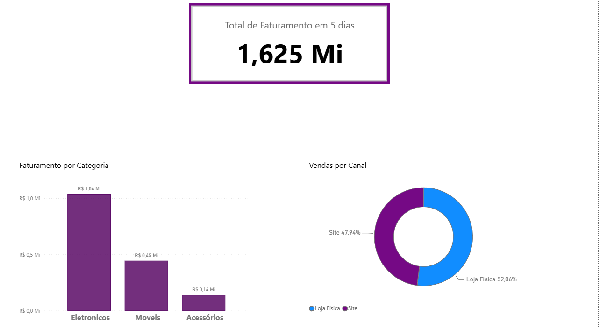

# Dashboard de Análise de Vendas e Faturamento

Primeiro projeto prático focado em extração de dados via CSV, limpeza básica e visualização de indicadores financeiros no Power BI.

## 🎯 Objetivo
Analisar o desempenho de vendas de uma loja de varejo em um período de 5 dias, identificando as categorias de produtos mais rentáveis e a distribuição de vendas por canal (Site vs. Loja Física).

## 🛠️ Ferramentas Utilizadas
* **Power BI Desktop:** Construção do painel e visualização de dados.
* **Power Query:** Tratamento de dados (correção de nomenclatura de categorias).
* **Base de Dados:** Arquivo `.csv` estruturado localmente.

## 📊 Visualização do Dashboard

## 💡 Principais Insights
1. A categoria de **Eletrônicos** representa a maior fatia da receita do período analisado.
2. O balanceamento de vendas entre canais mostra a força do e-commerce (Site) frente às Lojas Físicas.