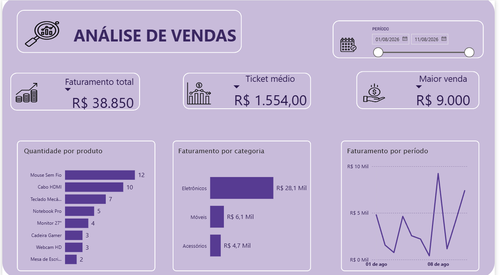

# Dashboard de Análise de Vendas com SQL e Power BI

Segundo projeto prático focado na integração entre extração e análise de dados via SQL e visualização de indicadores no Power BI.

## 🎯 Objetivo

Analisar os dados de vendas utilizando SQL para extração e agregação das informações e Power BI para criação de indicadores e visualizações que auxiliem na análise do desempenho das vendas.

## 🛠️ Ferramentas Utilizadas

- **SQL:** Extração, filtragem e agregação dos dados.
- **Power BI Desktop:** Construção do painel e visualização dos indicadores.
- **DAX:** Criação das medidas utilizadas no dashboard.
- **Power Query:** Importação e tratamento básico dos dados.
- **Base de Dados:** Resultado dos dados utilizados no exercício SQL, estruturado em arquivo `.csv`.

## 📊 Análises Realizadas

O dashboard busca responder às seguintes perguntas (com base nos dados consolidados):

1. **Qual foi o faturamento total?** O faturamento total alcançou **R$ 38.850,00**.
2. **Qual produto possui maior quantidade vendida?** O **Mouse Sem Fio** foi o campeão de volume, com **12 unidades vendidas**, seguido pelo **Cabo HDMI**, com **10 unidades**.
3. **Qual é o ticket médio?** O valor médio gasto por venda foi de **R$ 1.554,00**.
4. **Qual categoria apresenta maior faturamento?** A categoria de **Eletrônicos** apresentou o maior faturamento no período, gerando aproximadamente **R$ 28,1 mil** em receita.
5. **Qual foi a maior venda realizada?** O registro de maior valor em uma única venda alcançou **R$ 9.000,00**.
6. **Como as vendas se distribuem ao longo do período analisado?** Observou-se uma grande variação nas vendas diárias, com picos acentuados concentrados ao final da primeira semana de agosto.

---

## 📈 Visualização do Dashboard

## 💡 Principais Insights

1. **Forte dependência do setor de Eletrônicos:** A categoria "Eletrônicos" é a principal fonte de receita do negócio, gerando aproximadamente **4,6 vezes mais faturamento** do que a categoria que ficou em segundo lugar ("Móveis", com R$ 6,1 mil).

2. **Volume de saída vs. Valor de faturamento:** Embora os produtos de menor valor, como **Mouse Sem Fio** e **Cabo HDMI**, apresentem maior volume de unidades vendidas, vendas de maior valor também possuem impacto relevante no faturamento. O **ticket médio de R$ 1.554,00** e a maior venda de **R$ 9.000,00** evidenciam essa diferença entre volume de unidades e valor gerado.

3. **Picos e Vales de Vendas:** O gráfico de faturamento por período mostra que as vendas não são constantes. A receita sofre quedas em determinados dias e apresenta aumentos expressivos em outros, indicando a necessidade de investigar possíveis fatores externos ou sazonalidades que possam influenciar o comportamento das vendas.

## 🔗 Integração com SQL

A análise foi iniciada utilizando SQL para exploração e agregação dos dados. O resultado foi posteriormente utilizado como base para construção das visualizações no Power BI.

As consultas SQL utilizadas no projeto estão disponíveis na pasta `SQL/`.